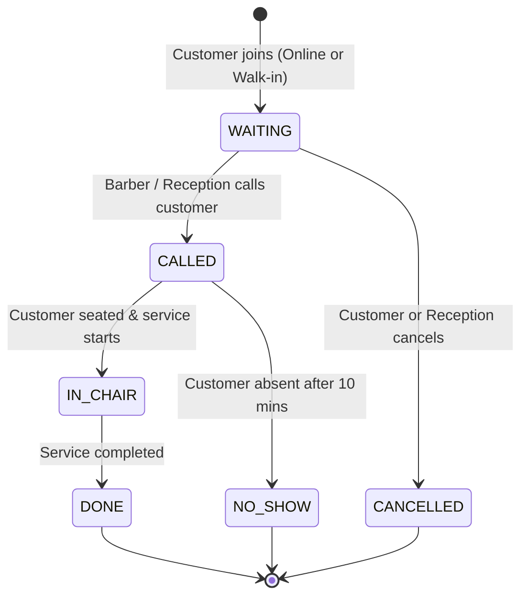

# 03-flows-rules.md — Queue Business Rules & State Transitions

This document defines the core business logic, lifecycle states, and queue management algorithms enforced by `src/services/queueLogic.ts`.

---

## 1. Ticket Lifecycle States

Each queue entry progresses through a deterministic lifecycle:

### State Definitions:
1. `WAITING`: Active in line, awaiting an eligible barber.
2. `CALLED`: Barber station is ready; customer has been summoned to station.
3. `IN_CHAIR`: Customer is seated; barber is actively performing the service.
4. `DONE`: Service concluded; transaction completed. **Terminal state.**
5. `CANCELLED`: Cancelled prior to service. **Terminal state.**
6. `NO_SHOW`: Called customer did not present within 10 minutes. **Terminal state.**

*Rule:* Once an entry reaches `DONE`, `CANCELLED`, or `NO_SHOW`, it can never transition back into an active queue status. Rejoining requires creating a new token at the end of the queue.

---

## 2. Dispatching & Barber Matching Rules

1. **First-Come, First-Served (FCFS) with Preference Priority:**
   - When Barber $B$ calls the next customer, the engine scans the waiting list ordered by `joinedAt` ascending.
   - It identifies the earliest customer who either:
     a) Selected Barber $B$ explicitly, OR
     b) Selected `"ANY"` available barber.
2. **Strict Exclusivity Rule:**
   - A customer who selected Barber $B_1$ must **NEVER** be assigned or dispatched to Barber $B_2$.
3. **Single Seat Constraint:**
   - A barber may only have **one** customer in the chair at any given moment.
   - A customer cannot be called to a barber who is `OFF_DUTY`, `ON_BREAK`, or already has an active customer.
4. **On-Break Handling:**
   - If a customer's preferred barber is on break, the customer remains waiting in their priority position. The UI informs the customer of the break without silently reassigning them.

---

## 3. Dynamic Wait Time Estimation Formula

Wait times are recalculated reactively whenever the queue changes or barber status updates:

### Case A: Customer selected a Specific Barber $B$
$$\text{Wait Time} = \text{Remaining Time of Current Client in Chair}(B) + \sum_{k \in \text{Ahead}_B} \text{Duration}(k)$$
Where $\text{Ahead}_B$ represents all waiting customers ahead in line who either requested Barber $B$ or selected `"ANY"` and may be serviced by $B$.

### Case B: Customer selected `"ANY"` Barber
$$\text{Wait Time} = \left\lceil \frac{\text{Total Unfinished Work of All Waiting Customers Ahead} + \sum \text{Remaining Chair Times}}{\text{Number of Active Working Barbers}} \right\rceil$$

---

## 4. Operational Business Rules

1. **Cutoff Rule for Online Queue:**
   - Online joining automatically closes **30 minutes prior to salon closing time**.
   - Walk-in customers continue to be accepted in person at reception until official closing time.
2. **Duplicate Entry Rule:**
   - A mobile phone number may only hold **one active token** (`WAITING`, `CALLED`, or `IN_CHAIR`) at a time.
   - Submitting an existing active phone number redirects to the current status view rather than creating a duplicate.
3. **Walk-Ins Placement:**
   - Walk-ins are registered by reception and appended to the **tail** of the shared waiting queue with a standard sequential token.
